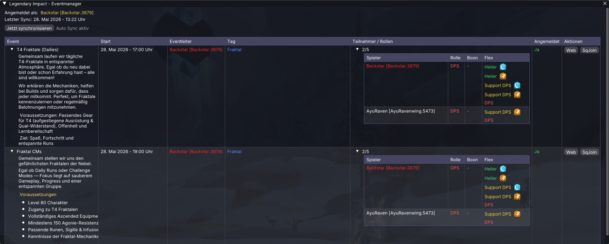
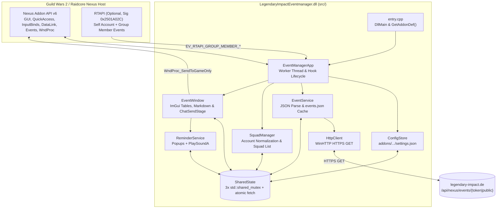

<p align="center">
  <a href="https://ko-fi.com/todd0042">
    
  </a>
</p>

---

# ⚔️ Legendary Impact - Eventmanager

[](src/entry.cpp)
[](LICENSE)
[](LegendaryImpactNexus.sln)
[](src/LegendaryImpactNexus.vcxproj)
[](src/nexus/Nexus.h)
[](https://ko-fi.com/todd0042)

> **Bring Legendary Impact community event scheduling, live RTAPI squad tracking, role/boon compositions, start reminders, and one-click `/sqjoin` directly into Guild Wars 2 inside the Raidcore Nexus overlay.**

<p align="center">
  
</p>

---

## 📖 Table of Contents

* **Part 1 — User Overview & Quick Start**
  * [⚔️ What Is Legendary Impact - Eventmanager?](#️-what-is-legendary-impact---eventmanager)
  * [🎯 How It Works in 3 Steps](#-how-it-works-in-3-steps)
  * [✨ Key Features at a Glance](#-key-features-at-a-glance)
  * [🚀 Installation & Building from Source](#-installation--building-from-source)
* **Part 2 — Technical Architecture & Reference**
  * [1. System Architecture & Threading Model](#1-system-architecture--threading-model) — [entry.cpp](src/entry.cpp), [EventManagerApp.h](src/EventManagerApp.h)
  * [2. Event Synchronization, API Contract & Offline Cache](#2-event-synchronization-api-contract--offline-cache) — [EventService.cpp](src/EventService.cpp), [HttpClient.cpp](src/HttpClient.cpp)
  * [3. RealTime API (RTAPI) Squad Matching & Auto `/sqjoin` State Machine](#3-realtime-api-rtapi-squad-matching--auto-sqjoin-state-machine) — [SquadManager.cpp](src/SquadManager.cpp), [EventWindow.cpp](src/EventWindow.cpp)
  * [4. Reminders, New-Event Announcements & ImGui UI](#4-reminders-new-event-announcements--imgui-ui) — [ReminderService.cpp](src/ReminderService.cpp), [Utility.cpp](src/Utility.cpp)
  * [5. Configuration Schema (`settings.json`), Keybinds & Embedded Resources](#5-configuration-schema-settingsjson-keybinds--embedded-resources) — [ConfigStore.cpp](src/ConfigStore.cpp), [Constants.h](src/Constants.h)
  * [6. Repository Structure & Dependencies](#6-repository-structure--dependencies) — [LegendaryImpactNexus.sln](LegendaryImpactNexus.sln), [.gitmodules](.gitmodules)
  * [7. Verification & Build Checks](#7-verification--build-checks) — [EventWindow.cpp](src/EventWindow.cpp)
  * [8. License & Support](#8-license--support) — [LICENSE](LICENSE)

---

# Part 1 — User Overview & Quick Start

## ⚔️ What Is Legendary Impact - Eventmanager?

**Legendary Impact - Eventmanager** is a native C++20 Windows x64 DLL addon for the **Raidcore Nexus** addon loader in **Guild Wars 2**. Instead of alt-tabbing to a browser to check raid, strike, fractal, or community signups, it surfaces the [legendary-impact.de](https://legendary-impact.de) event calendar directly inside the game's DirectX ImGui overlay.

With an optional personal API token (or unauthenticated public event feed fallback) and optional **GW2 RealTime API (RTAPI)** integration, the addon tracks your upcoming community events, highlights which signed-up attendees are already in your active in-game squad, alerts you before your events start, and lets you join your leader's squad with a single click.

---

## 🎯 How It Works in 3 Steps

1. **Install & Enable in Nexus**: Drop the compiled `LegendaryImpactEventmanager.dll` into `Guild Wars 2/addons/` and enable **Legendary Impact - Eventmanager** in the Nexus addons menu.
2. **Connect Your Account (Optional Token)**: Open Nexus Options for the addon, paste your **Legendary Impact Token** to see private guild events and your personal signup status (or leave blank to browse public events), and adjust your sync and reminder preferences.
3. **Track, Prepare & Join Squad**: Press `F8` (or click the Quick Access Pact icon) to inspect upcoming events, expand attendee roles and Quickness/Alacrity boon coverage, and click **Squad beitreten** within 15 minutes of event start to automatically send `/sqjoin <leader>` in GW2 chat.

---

## ✨ Key Features at a Glance

* **🔄 Automatic & Manual Event Sync**: Periodically fetches upcoming events from `https://legendary-impact.de/api/nexus/events/<token>` (or `/public` when no token is set) on a configurable `5–60` minute background timer, plus an in-window **Jetzt synchronisieren** button with a `10s` cooldown and persistent offline JSON caching.
* **👥 Live RTAPI Squad Matching**: Subscribes to Raidcore's `RTAPI` (`EV_RTAPI_GROUP_MEMBER_JOINED`, `UPDATED`, `LEFT`) to show whether each signed-up attendee is currently in your squad, along with their active character name and squad subgroup (`[1]`–`[15]`). Gracefully hides the Squad column if RTAPI is not installed.
* **🛡️ Role, Boon & Flex Composition Tables**: Displays color-coded roles (**DPS**, **Support DPS**, **Heiler**), embedded **Quickness** and **Alacrity** PNG icons, primary + flex roles, and lock icons for non-public internal events.
* **⚡ One-Click Auto `/sqjoin` (with Clipboard Fallback)**: Within `15` minutes of start (or while an event is active), signed-up attendees in multi-player events (`slotCount > 5`, non-`MEETING`) see a **Squad beitreten** button. **Left-click** injects `/sqjoin <leaderAccount>` directly into GW2 chat via `WndProc_SendToGameOnly`; **Right-click** copies the command to the Windows clipboard.
* **🔔 Upcoming Reminders & New Event Popups**: Plays a Windows `SystemExclamation` sound and opens an ImGui popup when a signed-up event is within your configurable lead window (`1–120` minutes, repeating every `1–60` minutes) or when new events appear between syncs.
* **📝 Markdown Event Descriptions & Browser Launch**: Renders event descriptions with `#`–`###` headers, blockquotes, checklists (`- [ ]` / `- [x]`), bullet/numbered lists, and UTF-8 emoji cleanup, plus an **Event anzeigen** button to open the event URL in your default browser.
* **⌨️ Quick Access & Keybinds**: Integrates into the Nexus Quick Access bar with hover icon states, supports **Close on Escape**, and registers `F8` (toggle window) and `F10` (close main window + all reminder popups).

---

## 🚀 Installation & Building from Source

### 📥 Prebuilt Addon Installation (Windows x64)

1. Obtain `LegendaryImpactEventmanager.dll` (from releases or by building `Release|x64` below).
2. Place the DLL into your Guild Wars 2 Nexus addons folder:
   ```text
   Guild Wars 2/addons/LegendaryImpactEventmanager.dll
   ```
3. Launch **Guild Wars 2**, open **Nexus**, and enable **Legendary Impact - Eventmanager**.
4. *(Recommended)* Install **RealTime API (RTAPI)** in Nexus for live squad member status, subgroup display, and fallback account-name detection.
5. Configure your **Legendary Impact Token** and reminder timers under **Nexus → Options → Legendary Impact - Eventmanager**. Settings and cached events are stored automatically under `addons/LegendaryImpactEventmanager/`.

### 🛠️ Building from Source

#### Prerequisites
* **OS**: Windows x64
* **IDE / Compiler**: Visual Studio 2022 (Platform Toolset `v143`, Windows SDK `10.0`)
* **Standard**: C++20 (`/std:c++20`, `/permissive-`, `/utf-8`)
* **Submodules**: `src/nexus`, `src/imgui`, `src/mumble`, `src/RTAPI`

#### Clone & Build Steps

```powershell
# 1. Clone with all required submodules (Nexus API, ImGui, Mumble, RTAPI)
git clone --recursive https://github.com/Todd0042/gw2-pact-nexus-plugin.git
cd gw2-pact-nexus-plugin

# If already cloned without --recursive:
git submodule update --init --recursive
```

Open [LegendaryImpactNexus.sln](LegendaryImpactNexus.sln) in **Visual Studio 2022**, select **`Release` | `x64`**, and build the `LegendaryImpactNexus` project—or build from a Developer Command Prompt via `MSBuild`:

```powershell
msbuild LegendaryImpactNexus.sln /p:Configuration=Release /p:Platform=x64
```

The compiled DLL is written to `out/LegendaryImpactEventmanager.dll` (or `out/LegendaryImpactEvents.dll` for `Debug|x64`).

---
---

# Part 2 — Technical Architecture & Reference

> *The sections below document the verified implementation of `v1.3.4.1` (`feat/auto-sqjoin-wndproc`) across every module in `src/`.*

---

## 1. System Architecture & Threading Model

The plugin is a Win32 DLL exporting `GetAddonDef()` in [src/entry.cpp](src/entry.cpp) (Nexus Signature `-84629`, `NEXUS_API_VERSION` `6`, `UP_GitHub` update provider). Lifecycle, threading, and Nexus hook orchestration are coordinated by [`EventManagerApp`](src/EventManagerApp.h).



### Thread Safety & Worker Loop ([src/EventManagerApp.cpp](src/EventManagerApp.cpp), [src/SharedState.cpp](src/SharedState.cpp))
* **Background Worker (`EventManagerApp::WorkerLoop`)**: Runs on `std::thread m_Worker` and waits on `std::condition_variable m_WorkerWake` for `refreshMinutes` (minimum `5` minutes), waking immediately on shutdown, manual sync (`RequestSyncNow`), or queued RTAPI squad events (`m_PendingSquadEvents`).
* **Synchronized Shared State (`SharedState`)**: Protects configuration (`m_ConfigMutex`), live event/viewer/squad state (`m_StateMutex`), and reminder window/cooldown state (`m_ReminderMutex`) with separate `std::shared_mutex` instances so ImGui render passes use non-blocking shared reads (`WithStateRead`) while background updates acquire exclusive locks (`UpdateState`). Concurrent fetches are prevented via an atomic CAS flag (`TryBeginFetch()` / `EndFetch()`).
* **Hot-Plug RTAPI Support**: Subscribes to `EV_ADDON_LOADED` and `EV_ADDON_UNLOADED`; when `RTAPI_SIG` (`0x2501A02C`) loads or unloads at runtime, [`EventManagerApp`](src/EventManagerApp.cpp) attaches or clears `DL_RTAPI` and `SquadManager` state without restarting the game.

---

## 2. Event Synchronization, API Contract & Offline Cache

Network transport and JSON deserialization are cleanly split between [`HttpClient`](src/HttpClient.h) and [`EventService`](src/EventService.h).

* **WinHTTP Client ([src/HttpClient.cpp](src/HttpClient.cpp))**:
  * Uses `WinHttpOpen` with User-Agent `LegendaryImpactEventmanager/1.0` and `WINHTTP_ACCESS_TYPE_DEFAULT_PROXY`.
  * Enforces timeouts (`5000ms` resolve/connect/send, `10000ms` receive), automatically enables `WINHTTP_FLAG_SECURE` for `https://`, and rejects non-`2xx` HTTP status codes.
* **Endpoint Selection (`EventService::BuildEventsUrl`)**:
  * Authenticated: `https://legendary-impact.de/api/nexus/events/<token>`
  * Public Fallback (empty token): `https://legendary-impact.de/api/nexus/events/public`
* **Parsed Data Model ([src/Models.h](src/Models.h), [src/EventService.cpp](src/EventService.cpp))**:
  * Extracts `viewer.username` / `viewer.gw2Account`, per-event metadata (`id`, `title`, `description`, `start`, `end`, `tag`, `location`, `url`, `isPublic`, `isViewerAttending`), `creator` (`leaderName`, `leaderAccount`), `_count.attendees`, summed `roleSlots[].count`, and `attendees` (`user`, `slot.group`, `selectedBoon`, and `flexRoles[]`).
  * Tracks `newEventIds` by comparing freshly fetched event IDs against previously known IDs (skipped on initial cold load when `oldEventIds` is empty).
* **Offline Persistence**: Every successful fetch writes pretty-printed JSON (`dump(4)`) to `addons/LegendaryImpactEventmanager/events.json`, which `LoadCachedEvents()` restores on startup before the first network sync completes.

---

## 3. RealTime API (RTAPI) Squad Matching & Auto `/sqjoin` State Machine

### Live Squad Tracking ([src/SquadManager.cpp](src/SquadManager.cpp))
* `EventManagerApp` buffers `EV_RTAPI_GROUP_MEMBER_JOINED`, `EV_RTAPI_GROUP_MEMBER_UPDATED`, and `EV_RTAPI_GROUP_MEMBER_LEFT` callbacks onto `m_PendingSquadEvents` and processes them on the worker thread.
* `SquadManager::NormalizeAccountName` strips any leading `:` prefix and lowercases the string so GW2 account names from RTAPI (`AccountName`) match Legendary Impact attendee records (`gw2Account`) reliably.
* When rendering the attendee sub-table, `EventWindow::RenderEventAttendeesTable` matches each attendee against `state.squadMembers` to render `squad.png` / `noSquad.png`, the member's active character name, and subgroup `[N]`.

### Gated Eligibility & Non-Blocking Chat Injection ([src/EventWindow.cpp](src/EventWindow.cpp))
The **Squad beitreten** button is evaluated live each frame so it appears and disappears automatically as events enter or leave the join window:

1. **Eligibility (`EventWindow::ShouldShowJoinButton`)**:
   * Event must have a non-empty `leaderAccount`, `slotCount > 5`, and `tag != "MEETING"`.
   * Viewer attendance is confirmed via `IsViewerAttending()`—treating `event.isViewerAttending` as a hint and cross-checking the attendee list against `state.viewerGw2Account` or (when unauthenticated) `m_RtApi->AccountName`.
   * Event start time must be within `kJoinLeadMinutes` (`15` minutes), or the event must currently be active (`Utility::IsEventActive`, `now` between `start` and `end`).
2. **Non-Blocking `ChatSendStage` State Machine (`TickChatSender`)**:
   * Runs once per render frame on the game's main thread (even if the main window is hidden mid-flight), resolving the GW2 window via `ArenaNet_Dx_Window_Class` (with fallbacks to `"Guild Wars 2"` or `GetForegroundWindow()`).
   * **`OpenChat`**: Injects `VK_RETURN` (`WM_KEYDOWN` + `WM_KEYUP`) via `m_Api->WndProc_SendToGameOnly` with hardware scan codes.
   * **`TypeText`** *(after `150ms`)*: Sends each character of `/sqjoin <leaderAccount>` as `WM_CHAR`.
   * **`Submit`** *(after `40ms`)*: Injects `VK_RETURN` to submit the command and resets to `Idle`.
   * **Right-Click Fallback**: Copies `/sqjoin <leaderAccount>` to the Windows clipboard via `Utility::CopyToClipboard`.

---

## 4. Reminders, New-Event Announcements & ImGui UI

* **Upcoming Event Reminders ([src/ReminderService.cpp](src/ReminderService.cpp))**:
  * Evaluated during `EventWindow::RenderAddonWindow()` when `reminderEnabled` is `true`.
  * Collects attended events where `0 <= (startTime - now) <= reminderMinutesBefore * 60` and enforces a per-event repeat cooldown of `reminderRepeatMinutes * 60` seconds (`MarkReminderShownIfAllowed`).
  * Opens `Legendary Impact - Eventmanager###LegendaryImpactReminder` showing a countdown (`Xh YYm` or `X Min.`) and plays `PlaySoundA("SystemExclamation", nullptr, SND_ALIAS | SND_ASYNC)`.
* **New Event Announcements**:
  * When `announceNewEventsEnabled` is `true`, displays `Legendary Impact - Eventmanager###LegendaryImpactNewEvents` once per newly discovered event ID (`MarkNewEventAnnouncementShownIfNeeded`) with `SystemExclamation` audio feedback.
* **Markdown, Date & Tag Formatting ([src/Utility.cpp](src/Utility.cpp), [src/EventWindow.cpp](src/EventWindow.cpp))**:
  * Parses ISO-8601 UTC timestamps (`_mkgmtime`) and formats them to local time in German display style (`DD. Mon YYYY - HH:MM Uhr`).
  * Strips UTF-8 emoji ranges (`StripEmojis`, `FixSpacesAfterEmojiStrip`) and trailing `"Rollen"` / `"Teilnehmer"` blocks (`CleanEventDescription`) before rendering `#`, `##`, `###`, `> `, `- [ ]`, `- [x]`, and bullet/ordered lists.
  * Maps event tags (`OPEN_WORLD`, `WVW`, `PVP`, `RAID`, `FRACTAL`, `STRIKE`, `MEETING`, `COMMUNITY`), roles (`BOONDPS`, `HEAL`, `DPS`), and boons (`QUICKNESS`, `ALACRITY`) to localized labels, colors, and embedded PNG icons.

---

## 5. Configuration Schema (`settings.json`), Keybinds & Embedded Resources

### Persistent Settings (`addons/LegendaryImpactEventmanager/settings.json`)
Managed by [`ConfigStore`](src/ConfigStore.cpp):

| JSON Key | Default | Valid Range / Constraints | Description |
| :--- | :--- | :--- | :--- |
| `token` | `""` | String (`char[512]` edit buffer) | Personal Legendary Impact API token (masked in UI with `ImGuiInputTextFlags_Password`). Empty string uses the `/public` endpoint. |
| `refreshMinutes` | `5` | `5–60` (clamped `>= 5`) | Background polling interval in minutes for `WorkerLoop`. |
| `showWindow` | `true` | Boolean | Persisted visibility state of the main event table window. |
| `reminderEnabled` | `true` | Boolean | Enables or disables pre-event reminder popups and sound alerts. |
| `reminderMinutesBefore` | `15` | `1–120` (clamped `>= 1`) | Lead time in minutes before event start when reminders trigger. |
| `reminderRepeatMinutes` | `5` | `1–60` (clamped `>= 1`) | Cooldown in minutes before repeating a reminder for the same event. |
| `announceNewEventsEnabled` | `true` | Boolean | Enables or disables popup announcements when new event IDs appear. |

### Nexus Keybinds & Identifiers ([src/Constants.h](src/Constants.h), [src/EventManagerApp.cpp](src/EventManagerApp.cpp))

| Identifier | Default / Value | Purpose |
| :--- | :--- | :--- |
| `KB_LI_EVENTMANAGER` | `F8` | Toggles main window visibility and saves `settings.json` (configurable in Nexus Keybinds). |
| `KB_LI_EVENTMANAGER_CLOSEALL` | `F10` | Closes the main window and dismisses all active reminder/new-event popups. |
| `QA_LI_EVENTMANAGER` | Quick Access Slot | Adds the Pact icon (`icon.png` / `icon_hover.png`) to the Nexus Quick Access bar. |
| Escape Handler | Window ID `...###LegendaryImpactEventmanagerWindow` | Registered via `GUI_RegisterCloseOnEscape` so pressing `Esc` closes the main window. |

### Embedded Win32 PNG Resources ([src/resource.h](src/resource.h), [src/LegendaryImpactNexus.rc](src/LegendaryImpactNexus.rc))
Loaded via `m_Api->Textures_LoadFromResource`: `icon.png` (`IDB_PNG1`), `icon_hover.png` (`IDB_PNG2`), `quickness.png` (`IDB_PNG3`), `alacrity.png` (`IDB_PNG4`), `squad.png` (`IDB_PNG5`), `noSquad.png` (`IDB_PNG6`), `pact.png` (`IDB_PNG7`), and `lock.png` (`IDB_PNG8`).

---

## 6. Repository Structure & Dependencies

```text
gw2-pact-nexus-plugin/
├── LegendaryImpactNexus.sln          # Visual Studio 2022 solution (Debug/Release x64 & x86)
├── LICENSE                           # MIT License (Copyright (c) 2023 Raidcore.GG)
├── .gitmodules                       # Submodules: nexus, imgui, mumble, RTAPI
├── docs/
│   └── screen.png                    # In-game ImGui overlay screenshot
└── src/
    ├── LegendaryImpactNexus.vcxproj  # MSBuild project (v143, C++20, WinHTTP/WinMM)
    ├── LegendaryImpactNexus.rc       # Win32 PNG resource definitions (IDB_PNG1–IDB_PNG8)
    ├── resource.h                    # Resource ID constants
    ├── entry.cpp                     # DLL entry point & Nexus GetAddonDef() export (v1.3.4.1)
    ├── EventManagerApp.h / .cpp      # Nexus/RTAPI hook lifecycle, worker thread & resource loader
    ├── Constants.h                   # API URL, file paths, keybind IDs & texture IDs
    ├── Models.h                      # PluginConfig, EventItem, EventAttendee, SquadMember, PluginState
    ├── SharedState.h / .cpp          # Thread-safe state, config & reminder tracking
    ├── ConfigStore.h / .cpp          # settings.json persistence & ImGui edit buffers
    ├── HttpClient.h / .cpp           # WinHTTP synchronous HTTPS GET client
    ├── EventService.h / .cpp         # Event API fetching, JSON parsing & events.json cache
    ├── SquadManager.h / .cpp         # RTAPI squad membership tracking & account normalization
    ├── ReminderService.h / .cpp      # Upcoming/new event reminder popups & SystemExclamation audio
    ├── EventWindow.h / .cpp          # Main ImGui UI, Nexus options & WndProc /sqjoin state machine
    ├── Utility.h / .cpp              # Emoji stripping, ISO-UTC parsing, German dates, tags & clipboard
    ├── resources/                    # Embedded PNG icons (boons, squad status, lock, Pact icon)
    ├── nlohmann/json.hpp             # Single-header JSON library
    ├── nexus/                        # Submodule: RaidcoreGG/RCGG-lib-nexus-api
    ├── imgui/                        # Submodule: RaidcoreGG/imgui
    ├── mumble/                       # Submodule: RaidcoreGG/RCGG-lib-mumble-api
    └── RTAPI/                        # Submodule: TyrianDeveloperCollective/GW2-RealTime-API-Releases
```

---

## 7. Verification & Build Checks

This repository does not currently include an automated unit or end-to-end test suite. Verification relies on MSBuild compilation and runtime/in-game diagnostic triggers:

* **Build Verification**: Compiling `LegendaryImpactNexus.sln` with `Release|x64` (`/std:c++20`, `/permissive-`, `/utf-8`, `v143` toolset) produces `out/LegendaryImpactEventmanager.dll`.
* **In-Game Options Test Triggers ([src/EventWindow.cpp](src/EventWindow.cpp))**:
  * **Test Reminder**: Fires `ReminderService::ShowReminder` with a sample `"Wing 4 Fullclear (Auch für Anfänger)"` (`RAID`) reminder popup and `SystemExclamation` sound.
  * **Test Neue Events**: Fires `ReminderService::ShowNewEventsAnnouncement` with sample `RAID`, `STRIKE`, and `FRACTAL` events.
* **Graceful Fallback Paths**:
  * Missing or unreachable API preserves the last cached state in `addons/LegendaryImpactEventmanager/events.json` and reports errors in `Letzter Sync: Fehler: ...`.
  * Missing `RTAPI` displays `RealTime API: Nicht installiert (eingeschränkte Funktionalität)` and omits the `Squad` column without blocking event browsing.

---

## 8. License & Support

* **License**: Distributed under the **[MIT License](LICENSE)** (`Copyright (c) 2023 Raidcore.GG`).
* **Credits**: Original development by **Backxtar**, powered by the **[Raidcore Nexus](https://github.com/RaidcoreGG)** addon framework and **[GW2-RealTime-API](https://github.com/TyrianDeveloperCollective/GW2-RealTime-API-Releases)**.

<p align="center">
  If you find these tools and enhancements helpful, consider supporting development:<br/><br/>
  <a href="https://ko-fi.com/todd0042" target="_blank">
    
  </a>
</p>

---

<p align="center">
  <a href="https://ko-fi.com/todd0042">
    
  </a>
</p>
